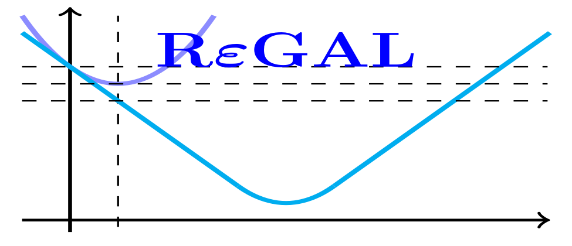
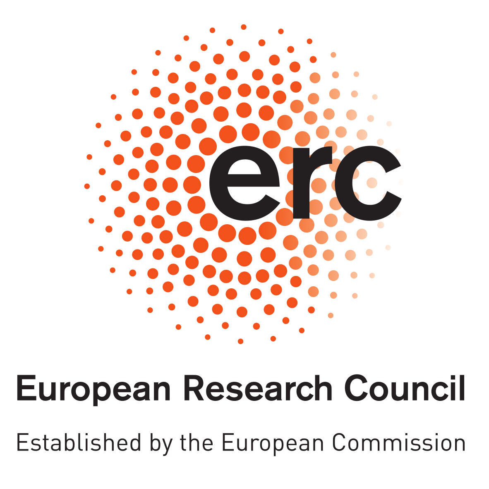

  
  &nbsp;&nbsp;&nbsp;&nbsp;
  

# REGAL Main repository

The project researches Moreau-Yosida regularization in density-functional theory (DFT). Funding from the ERC-2021-STG under grant agreement No 101041487 REGAL. The host institution is the Department of Mathematical Sciences, Chalmers University of Technology and the University of Gothenburg.

Funded by the European Union (ERC, REGAL, 101041487). Views and opinions expressed are however those of the author(s) only and do not necessarily reflect those of the European Union or the European Research Council Executive Agency. Neither the European Union nor the granting authority can be held responsible for them.

# Contents

## Team members

Each name links to that person's talks and posters.

+ PI: [A. Laestadius](https://github.com/ERC-REGAL/REGAL/tree/main/Talks/A.Laestadius)
+ Researcher: [M.A. Csirik](https://github.com/ERC-REGAL/REGAL/tree/main/Talks/M.A.Csirik)
+ Researcher: [M. Penz](https://github.com/ERC-REGAL/REGAL/tree/main/Talks/M.Penz)
+ Researcher (2025–2026): [O.M. Bohle](https://github.com/ERC-REGAL/REGAL/tree/main/Talks/O.Bohle)
+ PhD Research Fellow (2023–2026): [V.H. Bakkestuen](https://github.com/ERC-REGAL/REGAL/tree/main/Talks/V.Bakkestuen) (at the University of Geneva since 1 October 2026), defended the PhD thesis [*Mathematical and Theoretical Aspects of Density-Functional Theory*](https://hdl.handle.net/11250/5519168) on 8 June 2026
+ PhD Research Fellow: [M. Lotfigolian](https://github.com/ERC-REGAL/REGAL/tree/main/Talks/M.Lotfigolian)
+ PhD Research Fellow: [V. Falmår](https://github.com/ERC-REGAL/REGAL/tree/main/Talks/V.Falmar)
+ Master student (spring 2026): [F. Rumiz](https://github.com/ERC-REGAL/REGAL/tree/main/Talks/F.Rumiz), visiting the University of Oslo from the University of Trieste, master thesis in chemistry *Theoretical aspects of Kohn–Sham inversion in Density-Functional Theory*

## Publications

### Density-potential inversion from Moreau-Yosida regularization

+ [*Density-potential inversion from Moreau-Yosida regularization*](https://doi.org/10.1088/2516-1075/acc626) (2023) in *Electronic Structure*. Also available on [arXiv:2212.12727](https://arxiv.org/abs/2212.12727) **\[physics.chem-ph\]** 
+ [Python 3.7 script](https://github.com/ERC-REGAL/REGAL/tree/main/MY-ZMP) based on a script for many-particle systems in Slater basis on graphs: fermion-graph

   This script is part of the public domain CC0 1.0 Universal (CC0 1.0)

   Author: Markus Penz (2022)

   Main script is dens-pot-inversion.py includes the packages fermion_hamiltonian.py, graph_dft.py and timer.py

### The structure of the density-potential mapping. Part I: Standard density-functional theory

+ [*The structure of the density-potential mapping. Part I: Standard density-functional theory*](https://doi.org/10.1021/acsphyschemau.2c00069) (2023) in *ACS Physical Chemistry Au*. Also available on [arXiv:2211.16627](https://arxiv.org/abs/2211.16627) **\[physics.chem-ph\]** 

### The structure of the density-potential mapping. Part II: Including magnetic fields

+ [*The structure of the density-potential mapping. Part II: Including magnetic fields*](https://doi.org/10.1021/acsphyschemau.3c00006) (2023) in *ACS Physical Chemistry Au*. Also available on [arXiv:2303.01357](https://arxiv.org/abs/2303.01357) **\[physics.chem-ph\]** 

### Exchange energies with forces in density-functional theory 

+ [*Exchange energies with forces in density-functional theory*](https://doi.org/10.1063/5.0177346) (2024) in *The Journal of Chemical Physics* as a part of the *John Perdew Festschrift*. Also available on [arXiv:2203.16980](https://arxiv.org/abs/2203.16980) **\[physics.chem-ph\]**

### Exchange-only virial relation from the adiabatic connection

+ [*Exchange-only virial relation from the adiabatic connection*](https://doi.org/10.1063/5.0184934) (2024) in *The Journal of Chemical Physics* as a part of the *John Perdew Festschrift*. Also available on [arXiv:2310.19144](https://arxiv.org/abs/2310.19144) **\[physics.chem-ph\]**

### Thermodynamic limit for the magnetic uniform electron gas and representability of density-current pairs

+ [*Thermodynamic limit for the magnetic uniform electron gas and representability of density-current pairs*](https://doi.org/10.1063/5.0198786) (2024) in the *Journal of Mathematical Physics*. Also available on [arXiv:2401.10885](https://arxiv.org/abs/2401.10885) **\[math-ph\]**

### Quantum-Electrodynamical Density-Functional Theory Exemplified by the Quantum Rabi Model

+ [*Quantum-Electrodynamical Density-Functional Theory Exemplified by the Quantum Rabi Model*](https://doi.org/10.1021/acs.jpca.4c07690) (2025) in *The Journal of Physical Chemistry A*. Also available on [arXiv:2411.15256](https://arxiv.org/abs/2411.15256) **\[quant-ph\]**
+ Python scripts for reproducing the numerical results are available [here](https://github.com/VegardFalmaar/QEDFT-Quantum-Rabi-Code). The scripts build on existing methods from the [qmodel](https://github.com/magmage/qmodel) package.

### Density-functional theory for the Dicke Hamiltonian

+ [*Density-Functional Theory for the Dicke Hamiltonian*](https://doi.org/10.1007/s10955-025-03442-9) (2025) in the *Journal of Statistical Physics*. Also available on [arXiv:2409.13767](https://arxiv.org/abs/2409.13767) **\[math-ph\]**

### Kohn-Sham inversion with mathematical guarantees

+ [*Kohn-Sham inversion with mathematical guarantees*](https://doi.org/10.1103/PhysRevB.111.205143) (2025) in *Physical Review B*. Also available on [arXiv:2409.04372](https://arxiv.org/abs/2409.04372) **\[physics.chem-ph\]**

### Adaptation of Moreau-Yosida regularization to the modulus of convexity

+ [*Adaptation of Moreau-Yosida regularization to the modulus of convexity*](https://doi.org/10.1016/j.jmaa.2025.129956) (2026) in the *Journal of Mathematical Analysis and Applications*. Also available on [arXiv:2504.01772](https://arxiv.org/abs/2504.01772) **\[math.FA\]**

### Regularised density-potential inversion for periodic systems

+ [*Regularised Density-Potential Inversion for Periodic Systems: Application to Exact Exchange in One Dimension*](https://doi.org/10.1063/5.0310171) (2026) in *The Journal of Chemical Physics*. Also available on [arXiv:2510.24330](https://arxiv.org/abs/2510.24330) **\[physics.chem-ph\]**
+ The one-dimensional Hartree-Fock calculations use the open-source code [Sable](https://gitlab.com/et/sable-release), a 1D Hartree-Fock code by O.M. Bohle, M. Lotfigolian and E.I. Tellgren.

### Perspective on Moreau-Yosida regularization in density-functional theory

+ [*Perspective on Moreau-Yosida Regularization in Density-Functional Theory*](https://doi.org/10.1088/2516-1075/ae55eb) (2026) in *Electronic Structure*. Also available on [arXiv:2511.06957](https://arxiv.org/abs/2511.06957) **\[cond-mat.mtrl-sci\]**

### Neural network approximation of regularized density functionals

+ Preprint: *Neural network approximation of regularized density functionals* available on [arXiv:2511.18512](https://arxiv.org/abs/2511.18512) **\[physics.chem-ph\]**

### A quantitative Hohenberg-Kohn theorem in one spatial dimension

+ Preprint: *A quantitative Hohenberg-Kohn theorem and the unexpected regularity of density functional theory in one spatial dimension* available on [arXiv:2512.04726](https://arxiv.org/abs/2512.04726) **\[math-ph\]**
+ Accepted for publication in the *Journal of Spectral Theory* (October 2026).

### The non-uniform electron gas

+ Preprint: *The non-uniform electron gas* available on [arXiv:2603.21200](https://arxiv.org/abs/2603.21200) **\[math-ph\]**

### Moreau-Yosida-based Kohn-Sham inversion for periodic systems

+ Preprint: *Moreau-Yosida-based Kohn-Sham Inversion for Periodic Systems* available on [arXiv:2606.19471](https://arxiv.org/abs/2606.19471) **\[math.NA\]**
+ Julia code and data for reproducing the numerical results are available [here](https://github.com/vebjorhb/MY-periodic-inversion). The implementation builds on the [DFTK](https://github.com/JuliaMolSim/DFTK.jl) package.

### Equality of the jellium and the uniform electron gas energies

+ Preprint: *Equality of the Jellium and the Uniform Electron Gas Energies* available on [arXiv:2610.20910](https://arxiv.org/abs/2610.20910) **\[math-ph\]**
+ A Lean formalization of the lower and upper energy comparisons is available [here](https://github.com/xyzw/jellium_ueg).

### Counterexamples to the total-current Hohenberg-Kohn conjecture

+ Preprint: *Counterexamples to the total-current Hohenberg–Kohn conjecture* available on [arXiv:2610.27294](https://arxiv.org/abs/2610.27294) **\[math-ph\]**
+ A Lean formalization of the main results and the supporting arguments in the appendices is available [here](https://github.com/ERC-REGAL/mag_hk).

## Workshop on Density-Functional Theory in Oslo 2024
The presentation slides for several of the talks given at the *Workshop on Quantum Theory: Foundations and Extensions of Density-Functional Theory* in Oslo are available in [this folder](https://github.com/ERC-REGAL/REGAL/tree/main/Workshop-DFT-Oslo-2024). The workshop was held at the OsloMet campus Pilestredet, from the 2nd to the 6th of December 2024. See the [workshop webpage](https://uni.oslomet.no/quantum/workshop-foundations-and-extensions-of-dft/) for further details. 

## Workshop on Density-Functional Theory in Oslo 2026
The presentation slides for several of the talks given at the *Workshop on the Foundations and Extensions of Density-Functional Theory*, hosted by the ERC project REGAL in Oslo, are available in [this folder](https://github.com/ERC-REGAL/REGAL/tree/main/Workshop-REGAL-Oslo-2026). The workshop was held at the OsloMet campus Pilestredet, from the 20th to the 24th of April 2026. See the [workshop webpage](https://uni.oslomet.no/regal/workshop-foundations-and-extensions-of-dft/) for further details.

## DMP-REGAL

Data Management Plan, [version 1](https://github.com/ERC-REGAL/REGAL/tree/main/DMP-REGAL)

## License

The code in this repository, such as the [MY-ZMP](https://github.com/ERC-REGAL/REGAL/tree/main/MY-ZMP) scripts, is released under [CC0 1.0 Universal](https://github.com/ERC-REGAL/REGAL/blob/main/LICENSE). The talk slides and posters in the Talks and workshop folders remain the property of their authors and are shared here with their permission. They are not covered by the CC0 licence.
